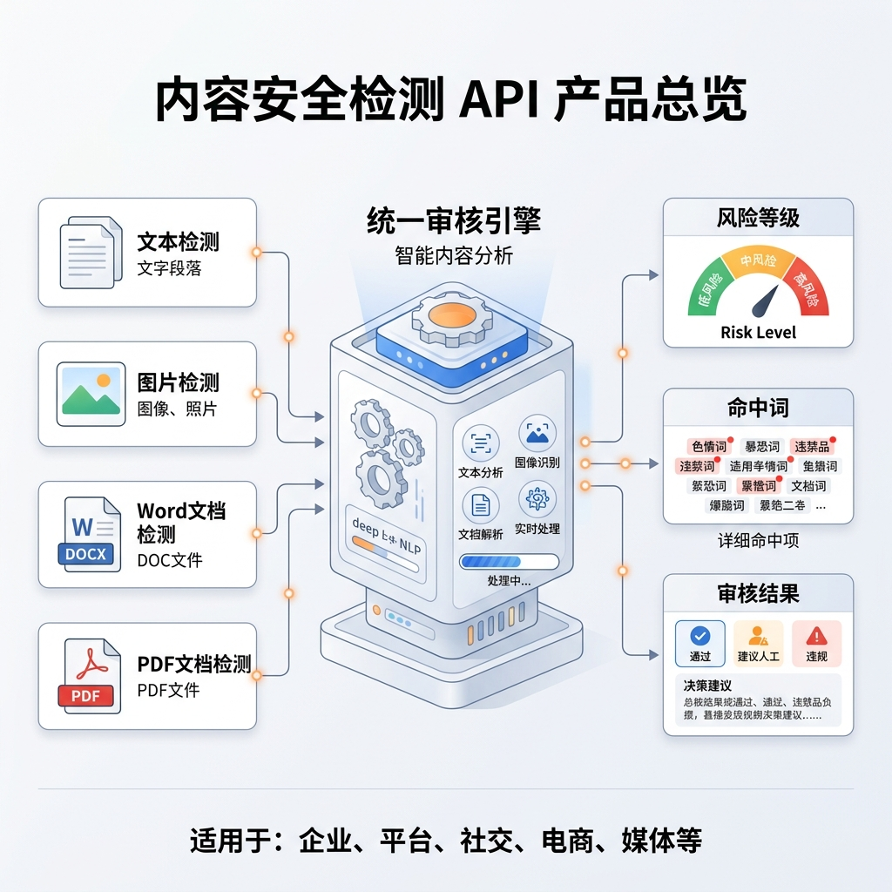
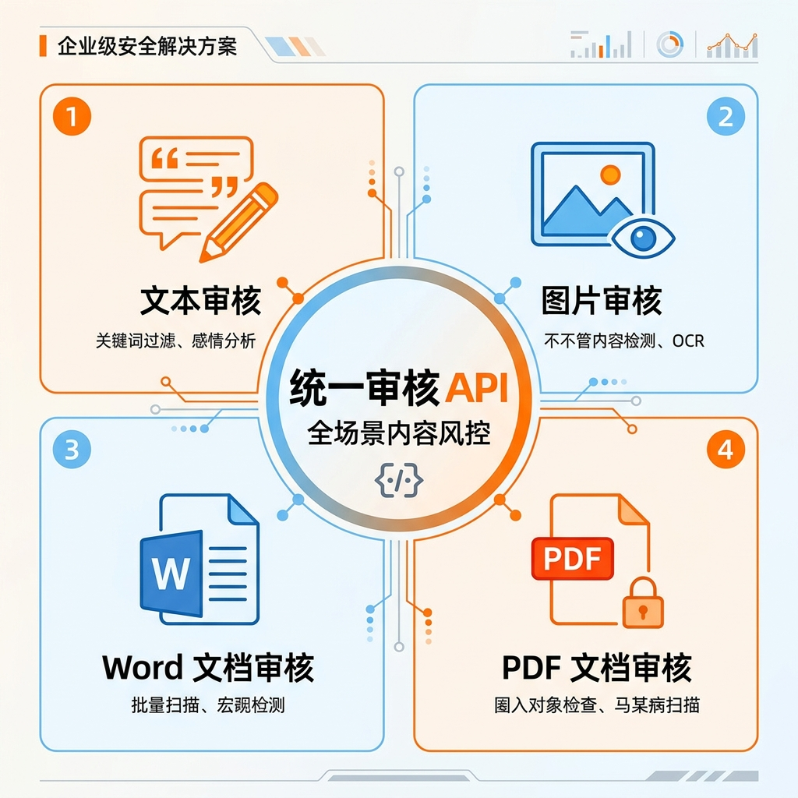
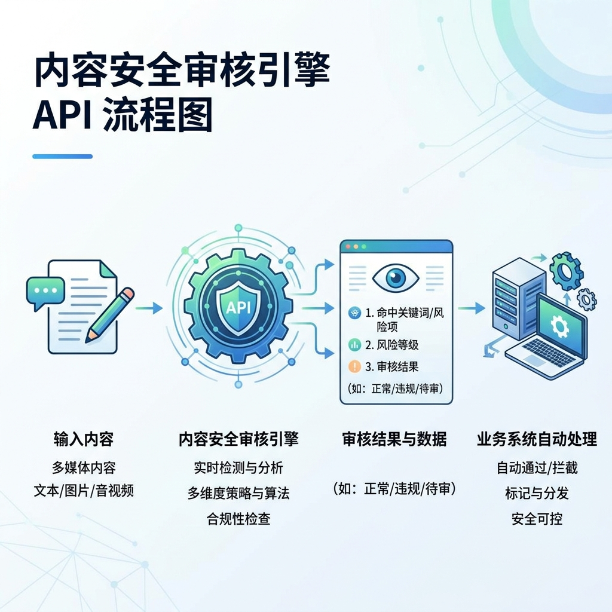
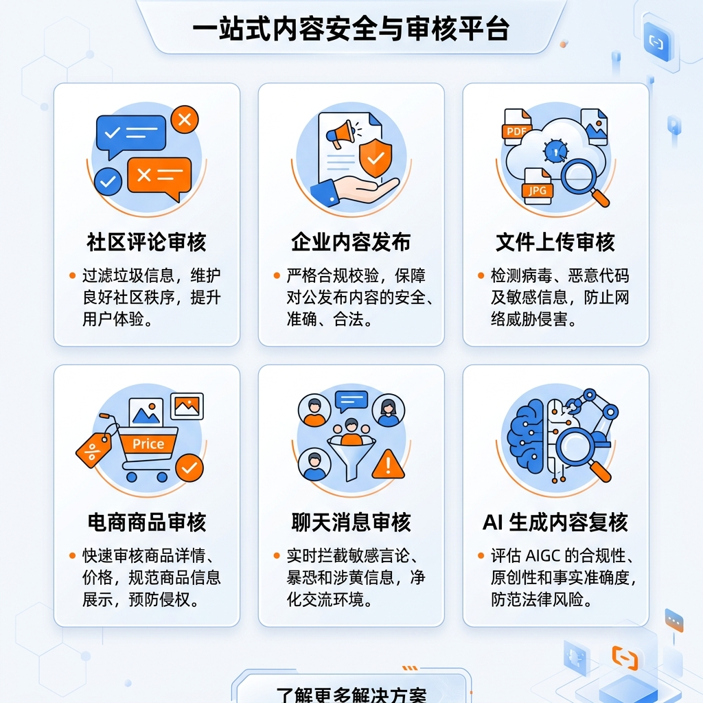
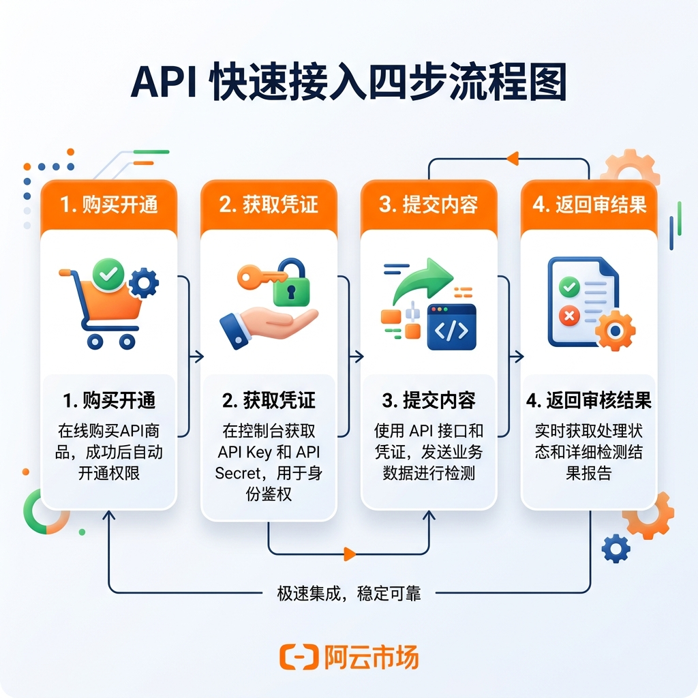
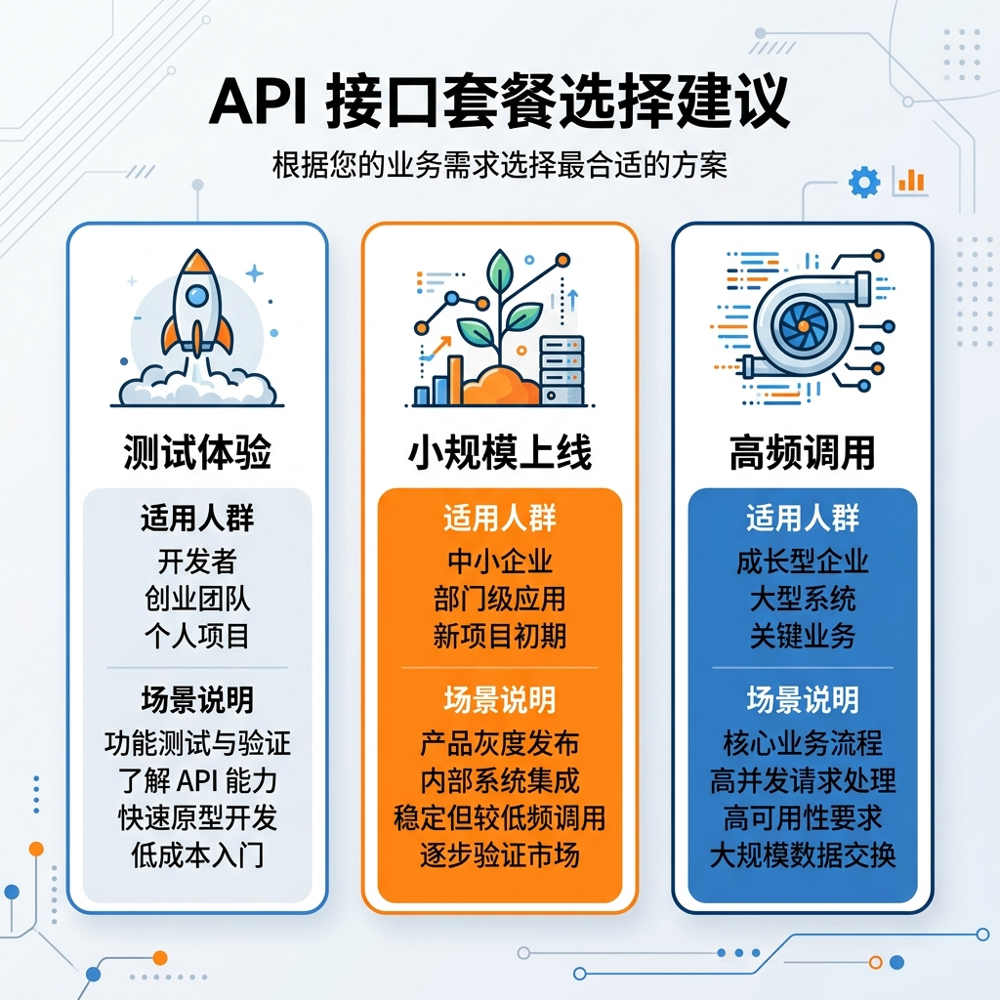
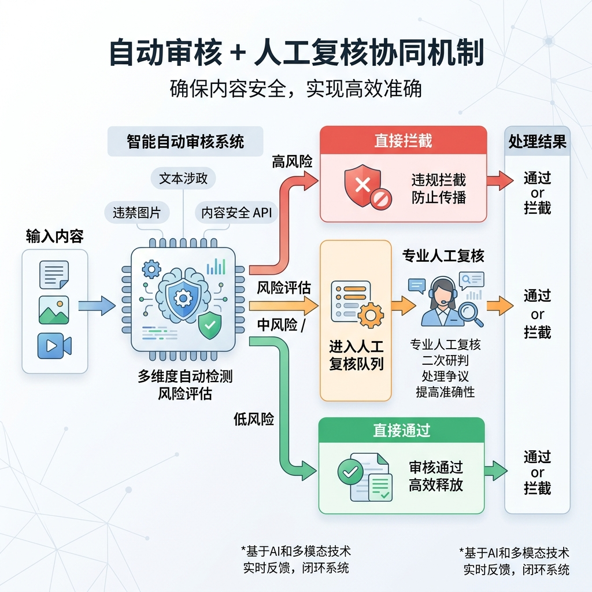
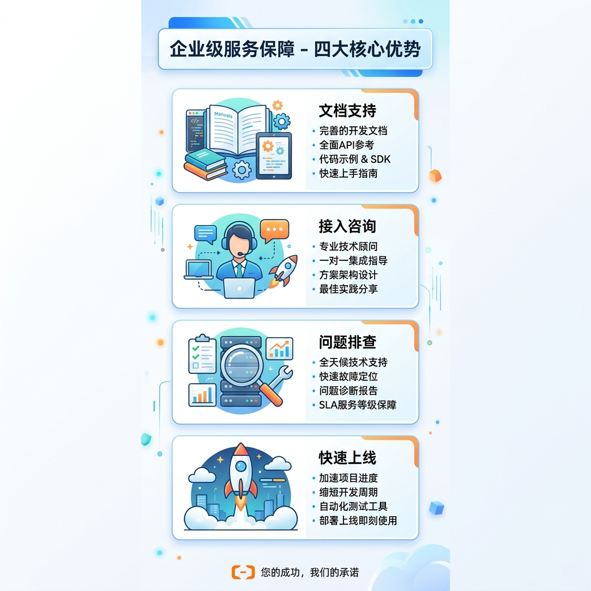

# 阿里云云市场商品页优化方案

适用商品：
- `cmapi00073537`
- 当前商品名：`文本和文档内容安全合规敏感词检测 API｜支持 Word/PDF/图片/Excel/PPT`

## 1. 当前页面关键信息

根据当前线上页面源码，可确认的核心字段如下：

- 当前 HTML `<title>`：`文本图片文档内容合规敏感词检测服务-云市场-阿里云`
- 当前 `meta keywords`：`了解内容安全检测API,内容安全API产品介绍,内容安全API功能特性,云市场,阿里云`
- 当前 `meta description`：
  `内容安全检测API是一站式高性能云端合规审查服务，可智能筛查文本、Word、PDF及图片等多种内容，毫秒级反馈风险，助您轻松规避内容违规风险，保障业务安全。`
- 当前商品主标题：
  `文本和文档内容安全合规敏感词检测 API｜支持 Word/PDF/图片/Excel/PPT`
- 当前主描述：
  `一站式内容安全检测 API 是一款面向企业和开发者提供的高性能云端合规审查服务。只需极简接入，即可实现对纯文本、Word、PDF、Excel、PPT 乃至各类型图片等主流格式内容的深度筛查。系统依托智能风险评估引擎，毫秒级返回命中词明细、风险等级及自动脱敏后的安全文本。协助您的业务系统、文件上传组件或内容社区，快速落地全自动化合规阻断防线，一键规避内容违规风险。`

## 2. 当前页面主要问题

### 2.1 搜索词布局不够集中

- 页面标题、商品主标题、Meta 描述使用的关键词不完全一致。
- `内容安全检测`、`敏感词检测`、`内容审核`、`文本审核`、`图片审核`、`文档审核 API` 这些高意图词没有形成稳定词组。
- `keywords` 过于泛，缺少用户真实搜索词，比如：
  - `敏感词检测 API`
  - `文本审核 API`
  - `图片内容审核 API`
  - `文档合规检测 API`
  - `PDF 敏感词检测`
  - `OCR 图片文字审核`

### 2.2 转化表达偏“泛能力”，缺少“场景化”

- 现在文案更像技术简介，不像购买页。
- 用户能看到“高性能、毫秒级、深度筛查”，但不容易迅速判断：
  - 能审什么风险
  - 适合什么业务
  - 返回什么结果
  - 如何接入
  - 买哪档套餐

### 2.3 信任建立还不够具体

- 目前主要使用泛化词：`高性能`、`极简接入`、`深度筛查`、`自动化合规阻断防线`
- 这类词能体现方向，但不够“落地”。
- 更利于成交的信任信息应该是：
  - 检测对象有哪些
  - 返回字段有哪些
  - 支持哪些接入方式
  - 是否有示例代码
  - 是否支持企业场景定制
  - 检测边界是什么

### 2.4 商品说明更适合做成“图文模块化长图”

- 阿里云市场帮助信息显示，商品详情通常以图片形式承载更稳定，适合做长图分模块展示。
- 因此建议：
  - 标题、短描述、SEO 信息继续优化文字
  - 商品说明主内容改造成 6 到 8 张模块化详情图

## 3. 优化目标

优化后的页面要同时满足三件事：

1. 搜索更容易命中
2. 用户 10 秒内看懂产品能解决什么问题
3. 用户在查看详情时形成“专业、稳定、可接入、值得下单”的感受

## 4. 建议的页面信息结构

建议采用以下结构：

1. 主标题
2. 短描述
3. 首屏卖点摘要
4. 商品说明模块 1：产品定位与价值
5. 商品说明模块 2：支持检测对象
6. 商品说明模块 3：核心能力与返回结果
7. 商品说明模块 4：适用场景
8. 商品说明模块 5：接入方式与调用流程
9. 商品说明模块 6：套餐建议与选购建议
10. 商品说明模块 7：服务边界与使用建议
11. 商品说明模块 8：服务保障与售后支持

## 5. 标题优化建议

以下标题优先兼顾搜索与转化，建议控制在用户一眼可读范围内。

### 标题方案 A

`内容安全检测 API｜文本/图片/Word/PDF 文档敏感词与合规审核`

优点：
- 核心词齐全
- 用户一眼就能知道支持哪些对象
- 兼顾 `内容安全检测 API` 与 `敏感词检测`

### 标题方案 B

`敏感词检测与内容审核 API｜支持文本、图片、Word、PDF 文档`

优点：
- 更偏用户搜索表达
- 强化 `敏感词检测` 和 `内容审核`

### 标题方案 C

`文本图片文档内容审核 API｜支持 Word/PDF/OCR 敏感词与合规检测`

优点：
- 更突出多模态和文档能力
- 适合强调图片文字识别后的审核能力

### 推荐标题

`内容安全检测 API｜文本/图片/Word/PDF 文档敏感词与合规审核`

## 6. 短描述优化建议

### 推荐短描述

`面向企业系统、内容平台与开发者的内容安全检测 API，支持文本、图片、Word、PDF 等多种内容审核，识别敏感词及违规风险，返回命中词、风险等级与处理依据，适用于内容发布审核、文件上传审核、评论与消息风控等场景。`

### 备选短描述

`提供文本、图片和文档内容合规检测能力，支持敏感词识别、违规内容筛查与风险结果返回，适合社区内容审核、企业文档审核、电商内容校验、AI 生成内容风控等业务快速接入。`

## 7. 首屏卖点摘要建议

这一部分适合放在主图或首屏说明区，可拆成 4 个短卖点：

- 支持文本、图片、Word、PDF 等多种内容检测
- 返回命中词、风险等级、审核结果，便于系统自动处理
- 适用于评论审核、文档上传审核、内容发布审核、AI 内容风控
- 标准 HTTP API 接入，适合企业系统与开发者快速集成

## 8. 商品说明优化稿

下面内容按“详情图模块”设计，每个模块都可单独做一张图。

---

## 模块 1：产品定位

### 标题

`多内容类型合规审核 API，帮助业务快速建立内容安全防线`

### 正文

本产品面向企业业务系统、内容平台和开发者，提供文本、图片及文档内容的合规检测能力。  
支持对敏感词、违规风险内容进行自动识别，适用于内容发布前校验、上传文件审核、评论与消息审核、AI 生成内容复核等场景。  
通过标准 API 接入，帮助业务快速搭建自动化审核流程，降低内容违规风险和人工审核成本。

### 适合配图

- 产品总览信息图

### 图片占位符

### AI 出图提示词

`为企业级 SaaS/API 商品页生成一张横版产品总览图，主题是“内容安全检测 API”，画面包含文本、图片、Word、PDF 四类内容入口汇聚到统一审核引擎，再输出风险等级、命中词、审核结果。风格要求：专业、可信、简洁、企业级、阿里云生态兼容感、浅色背景、橙蓝点缀、信息图风格、2D 矢量科技插画、无真人、无复杂装饰、适合中文商业产品详情页。`

---

## 模块 2：支持检测对象

### 标题

`支持文本、图片与主流文档格式审核`

### 正文

产品支持对多种业务常见内容进行检测，适合统一接入不同来源的数据内容：

- 文本内容：评论、帖子、聊天消息、表单输入、文章正文、商品文案
- 图片内容：图片本身内容识别，以及图片内文字相关风险识别
- 文档内容：Word、PDF 等上传文档内容检测
- 办公文件场景：适用于企业资料、业务附件、内部提交材料等审核需求

无论内容来自前台用户提交、后台运营发布，还是业务系统上传文件，均可通过统一接口完成审核。

### 适合配图

- 四宫格能力图

### 图片占位符

### AI 出图提示词

`生成一张企业级 API 商品详情图，展示四类内容审核对象：文本、图片、Word 文档、PDF 文档。采用四宫格布局，每个区域有清晰图标和简洁标签，中心突出“统一审核 API”。风格：扁平化信息图、科技感、简洁留白、高级商务风、浅底色、橙色和蓝色作为强调色、中文产品页视觉、适合作为阿里云市场详情图。`

---

## 模块 3：核心能力与返回结果

### 标题

`不仅判断风险，还返回可用于业务处理的审核结果`

### 正文

相比只给出“通过/不通过”的简单结果，本产品更适合接入真实业务流程：

- 支持识别敏感词及违规风险内容
- 返回命中词信息，便于定位问题内容
- 返回风险等级，便于区分拦截、人工复核、直接通过等策略
- 支持输出审核结果，方便业务系统自动化处理
- 适合与内容发布、文档上传、风控拦截等流程联动

对于需要做自动化审核的业务，返回结构是否足够清晰，往往比单纯“能检测”更重要。

### 适合配图

- 输入内容 -> 审核引擎 -> 输出结果流程图

### 图片占位符

### AI 出图提示词

`制作一张中文企业级流程信息图，展示“输入内容 -> 内容安全审核引擎 -> 返回命中词、风险等级、审核结果 -> 业务系统自动处理”的流程。要求横版，结构清晰，适合 API 商品页，包含简洁图标与少量中文标签，浅色背景，专业科技感，商务风，不要夸张特效，不要真人。`

---

## 模块 4：适用场景

### 标题

`覆盖内容平台、企业系统与文件审核等典型业务场景`

### 正文

产品适用于以下常见业务场景：

- 内容社区与 UGC 平台：评论、帖子、用户发布内容审核
- 企业门户与资讯系统：文章、公告、运营内容发布前校验
- 文件上传场景：Word、PDF 等文档上传前审核
- 电商与交易场景：商品文案、图片、说明内容风险筛查
- IM 与客服系统：聊天消息、咨询内容、工单内容审核
- AI 生成内容场景：大模型输出内容二次复核与风控拦截

如果你的业务同时存在文本输入、图片上传和文档提交，这类统一内容审核 API 的接入价值会更高。

### 适合配图

- 多场景业务分布图

### 图片占位符

### AI 出图提示词

`生成一张中文企业产品详情页场景图，展示六个典型业务场景：社区评论审核、企业内容发布、文件上传审核、电商商品审核、聊天消息审核、AI 生成内容复核。使用统一风格的场景图标或小型界面卡片，排版整齐，信息密度中等，商务科技风，浅底、橙蓝点缀、适合阿里云市场商品详情页。`

---

## 模块 5：接入方式与调用流程

### 标题

`标准 API 接入，适合快速集成到现有业务系统`

### 正文

产品提供标准 API 调用方式，适合企业系统与开发者快速接入：

1. 购买商品并获取调用凭证
2. 按接口文档完成请求参数配置
3. 提交文本、图片或文档内容
4. 接收审核结果并接入业务处理流程

适用于：

- 前端表单提交前校验
- 后端内容入库前审核
- 文件上传流程中的异步审核
- 内容发布流程中的自动拦截或人工复核分流

对于采购方来说，是否“容易接入”直接影响下单决策，因此这一部分建议配合示意图明确展示。

### 适合配图

- 四步接入流程图

### 图片占位符

### AI 出图提示词

`为中文 API 商品页生成一张四步接入流程图：购买开通、获取凭证、提交内容、返回审核结果。使用编号步骤卡片和简洁图标，企业软件风格，浅色背景，高可读性，橙蓝配色，信息图排版，适合阿里云市场详情图。`

---

## 模块 6：套餐建议与选购建议

### 标题

`按调用规模选择套餐，先试用再上线更稳妥`

### 正文

建议按业务阶段选择套餐：

- 测试体验阶段：优先使用试用或小量调用套餐，验证接口能力与结果格式
- 小规模上线阶段：适合中小业务量场景，满足日常内容审核需求
- 高频调用阶段：适合内容平台、文件审核平台或大批量业务场景

对于首次接入的用户，建议先验证以下三件事：

- 是否满足业务需要的审核对象
- 返回字段是否方便系统自动处理
- 实际接入链路是否符合现有业务架构

### 适合配图

- 套餐选择建议卡片图

### 图片占位符

### AI 出图提示词

`生成一张中文商品详情页套餐选择建议图，分为“测试体验”“小规模上线”“高频调用”三档，每档有简洁图标、适用人群和场景说明。视觉风格专业、简洁、商务科技风，适合 API 商品销售页，浅底色、橙蓝强调、排版清晰。`

---

## 模块 7：服务边界与使用建议

### 标题

`适合作为自动化审核能力接入，复杂场景建议结合人工复核`

### 正文

为了帮助用户建立合理预期，建议在商品说明中明确以下内容：

- 本产品适合作为业务系统中的自动化审核能力接入
- 对于高风险、高争议或强行业语境内容，建议结合人工复核
- 图片与文档审核结果可能受到内容清晰度、排版质量、文件质量等因素影响
- 实际拦截策略建议结合业务规则、场景容忍度和人工审核机制共同设计

清晰说明边界，不会降低转化，反而会增强专业度与信任感。

### 适合配图

- 自动审核与人工复核协同示意图

### 图片占位符

### AI 出图提示词

`制作一张中文企业级示意图，主题是“自动审核 + 人工复核协同机制”。画面展示系统先自动检测，再根据风险等级进入通过、拦截、人工复核三个分支。风格克制、专业、可信、简洁信息图，浅色商务科技风，适合内容安全 API 商品详情页。`

---

## 模块 8：服务保障与支持

### 标题

`帮助用户完成购买、接入与上线，而不仅仅是提供一个接口`

### 正文

建议在商品说明中突出以下服务信号：

- 提供接口文档与示例说明
- 支持接入咨询与问题排查
- 适合企业采购与开发者快速验证
- 可用于业务系统、文件审核组件、内容平台等场景接入

如果后续支持更细的词库策略、定制化能力或企业方案，也可在这一模块进一步增强信任感。

### 适合配图

- 服务支持与上线保障图

### 图片占位符

### AI 出图提示词

`生成一张中文企业级服务保障信息图，主题是“文档支持、接入咨询、问题排查、快速上线”。画面使用四个服务图标模块，风格现代商务、专业可信、浅色底、高可读性、适合阿里云市场 API 商品详情长图。`

## 9. 建议保留为文字的信息

以下内容建议继续保留为可检索文字，而不是全部做进图片：

- 商品标题
- 商品短描述
- SEO 标题
- Meta description
- 商品关键搜索词

原因：

- 文字更有利于平台搜索和外部搜索识别
- 图片更适合转化，但不利于搜索抓取

## 10. 建议做成图片的信息

以下内容适合做成商品说明长图：

- 产品定位
- 支持检测对象
- 核心能力
- 适用场景
- 接入流程
- 套餐选择建议
- 服务边界
- 服务保障

## 11. SEO 关键词建议

建议围绕高意图关键词组合进行布局：

- 内容安全检测 API
- 敏感词检测 API
- 内容审核 API
- 文本审核 API
- 图片审核 API
- 文档审核 API
- Word 文档审核
- PDF 敏感词检测
- 图片文字审核
- OCR 内容审核
- 文件上传审核 API
- 合规检测 API

## 12. 建议最终落地版本

### 标题

`内容安全检测 API｜文本/图片/Word/PDF 文档敏感词与合规审核`

### 短描述

`面向企业系统、内容平台与开发者的内容安全检测 API，支持文本、图片、Word、PDF 等多种内容审核，识别敏感词及违规风险，返回命中词、风险等级与处理依据，适用于内容发布审核、文件上传审核、评论与消息风控等场景。`

### 详情图模块顺序

1. 产品定位总览图
2. 支持检测对象图
3. 核心能力与返回结果流程图
4. 典型应用场景图
5. 接入流程图
6. 套餐选择建议图
7. 审核边界与协同机制图
8. 服务保障图

## 13. 下一步建议

建议按以下顺序推进：

1. 先定标题和短描述
2. 再定 8 个详情图模块文案
3. 使用 AI 大模型生成首版图片
4. 对图片做统一视觉风格修正
5. 回填到阿里云商品说明区域

## 参考来源

- 当前商品页：
  - https://market.aliyun.com/detail/cmapi00073537
- 阿里云帮助中心（营销页与商品发布相关信息）：
  - https://help.aliyun.com/zh/csp/user-guide/marketing-management-tools
  - https://help.aliyun.com/zh/marketplace/user-guide/user-faqs
